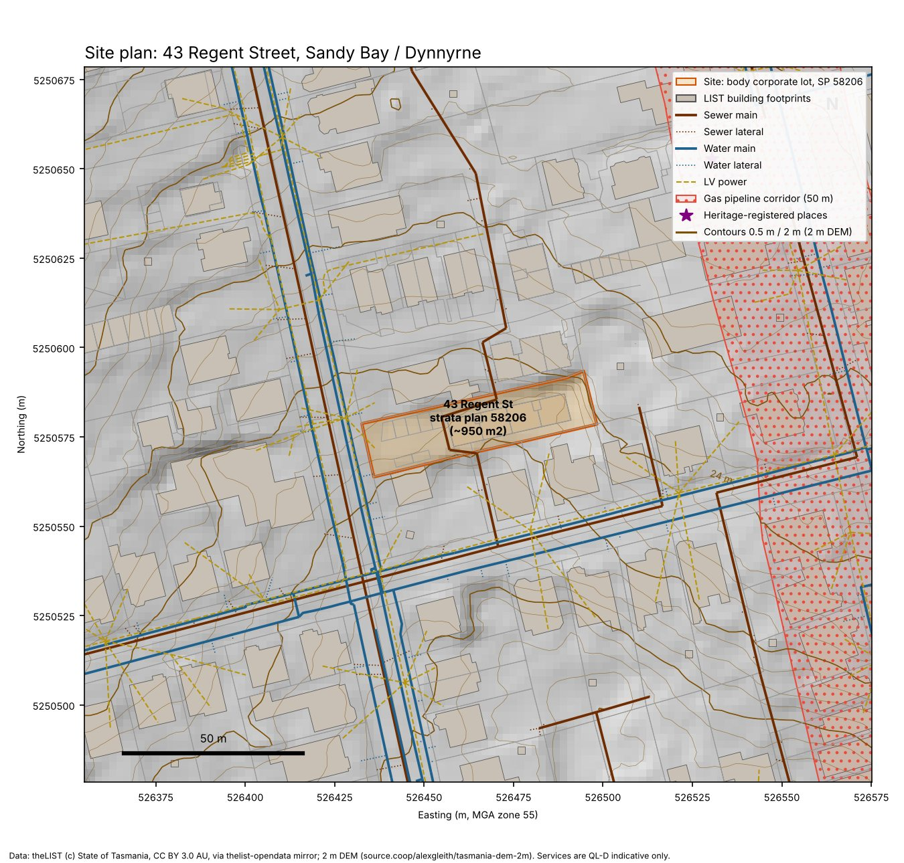
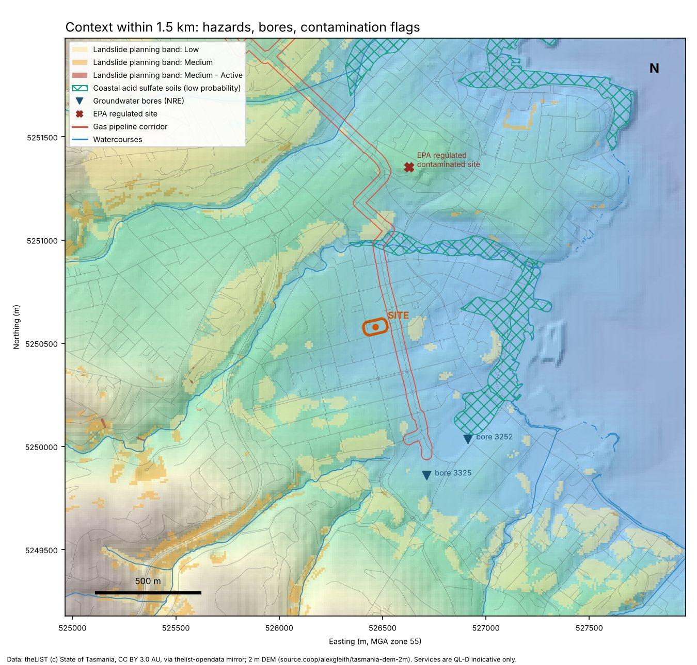

A desk-study pack built only from open data, to take to site before drilling or test pitting. It is not a geotechnical assessment.

## Summary

**Site.** 43 Regent Street, Hobart. theLIST places this address in **Sandy Bay**; the street runs along the Sandy Bay and Dynnyrne boundary, so both names are in use. It is **Strata Plan 58206**: a body corporate lot of about **950 m2** holding 8 strata units in two building footprints.

**Likely ground, to be confirmed.** A gently south-sloping urban lot at about **22-24 m AHD**. Regional soil mapping shows dolerite-derived black clay soils. The two nearest water bores (about 700 m south-east) found water in **Tertiary basalt** at 24-37 m depth and in **Tertiary sediments**. The site geology has not been confirmed against MRT mapping.

**Key flags**

- **A sewer main crosses the lot** (150 mm concrete and vitrified clay). Locate it before any drilling.
- **Gas pipeline.** The edge of a declared gas pipeline corridor (PE, 1000 kPa, 50 m wide) is about 40 m east.
- **Water mains.** A 375 mm steel and a 100 mm cast-iron water main run about 5 m off the boundary in Regent Street.
- **Heritage.** The lot is inside a Local Heritage Precinct, with six heritage-registered places within 150 m.
- **Landslide and acid sulfate soils.** No landslide planning band on the lot; the nearest is a Low band 124 m away. No acid sulfate soil mapping on the lot.
- **Contamination.** One EPA-regulated contaminated site is about 770 m north, and the lot has aerial photo coverage back to 1946.

## Site and title

| Item | Value | Source layer |
|---|---|---|
| Address | 43 Regent Street, Sandy Bay TAS 7005 (8 units) | `list_address_points` |
| Title | Strata Plan 58206, body corporate lot plus 8 vertical-strata units | `list_parcels` |
| Lot area | about 948 m2 | `list_parcels` |
| Lot centre | E 526465, N 5250579 (GDA94 / MGA zone 55) | computed |
| Buildings | 2 residential footprints, about 256 m2 and 91 m2 | `list_2d_building_polys` |
| Zone | Inner Residential (Hobart Local Provisions Schedule) | `tasmanian_planning_scheme_zones` |
| Access | Street frontage to Regent Street; a tight urban lot, so plan for small-rig or hand methods | `list_transport_segments` |

**Services near or within the lot** (LIST utility layers; positions are Quality Level D under AS 5488, so indicative only):

- **Sewer:** a 150 mm main runs **through the lot**, with uPVC laterals within 2-10 m.
- **Water:** a 375 mm mild-steel cement-lined main and a 100 mm cast-iron cement-lined main run about 4-5 m off the boundary.
- **Power:** low-voltage service lines reach the lot.
- **Gas:** a declared pipeline corridor lies about 40 m east.
- **Easements:** the LIST easement layer shows none within 5 m. Given the sewer main, check the strata plan and title for a drainage or sewerage easement.

## Topography and drainage

- **Elevation on the lot:** 21.9 to 24.2 m (mean 22.6 m). Within 50 m it ranges from 19.3 to 27.2 m.
- **Slope:** about 5 degrees on average, falling to the south. Local maxima near 22 degrees are steps at building edges or retaining walls, not natural slope.
- **Drainage:** no mapped watercourse within 300 m. The site drains south and south-east towards lower Sandy Bay.
- **Cut and fill:** the contours bend around the building platform, which suggests some benching or fill. Expect possible fill near the buildings.

## Geology and soils

- **Soil mapping (1:100,000 reconnaissance):** unit Bld1, black soils on dolerite: moderately well-drained black soils on Jurassic dolerite bedrock and colluvium. A regional indication only. Expect reactive clay.
- **Bedrock, inferred and unconfirmed:** the nearest bores report Tertiary basalt and Tertiary sediments. This fits published accounts of a down-faulted Tertiary block in lower Sandy Bay. The site could sit on Tertiary sediments or basalt, on dolerite or its colluvium, or on Permian mudstone.
- **Acid sulfate soils:** none mapped on the lot. The nearest unit is low-probability, 342 m away.
- **Engineering geology reference:** the MRT report *Engineering geology of the Greater Hobart area* (1991) covers Sandy Bay.

## Groundwater

| Bore | Distance | Drilled | Depth | Water struck (yield) | Aquifer | Other |
|---|---|---|---|---|---|---|
| 3252 | about 685 m SE | 1987 | 48.8 m | 24.4-36.6 m (4.54 L/s) | Tertiary basalt | functioning (1987) |
| 3325 | about 751 m SSE | 1967 | not recorded | not recorded | Tertiary sediments | final TDS 2,463 mg/L (brackish) |

Both bores are lower in the landscape and nearer the coast than the site, and neither records a standing water level. A **shallow perched water table** in clay or fill over weathered rock is the more likely issue for footings and pits than the deep aquifer.

## Geohazards

| Hazard | On the lot? | Nearest |
|---|---|---|
| Landslide, deep-seated (Hobart-Glenorchy scenario) | No | Low band, 124 m |
| Rockfall source and runout | No | Medium, 461 m |
| Mapped slides, recently active | No | Medium-Active, 866 m |
| Debris flow runout | No | Low to Medium, 950-1,050 m |
| Historic flooding | No | none in the mirrored historic flood extents |
| Coastal erosion and inundation | No | site is about 22 m AHD and well inland |

## Contamination desk check

- **Current use:** residential strata units.
- **EPA regulated sites:** one within 1.5 km, about 772 m north on the far side of the Sandy Bay Rivulet valley. A direct pathway is unlikely.
- **Underground fuel tanks: not checked.** The mirror's `epa_underground_petroleum_storage_systems` file holds the gas pipeline corridor, not tank records, so this check has to be done against the EPA or WorkSafe registers directly.
- **Aerial photo history:** the LIST aerial photo index shows 475 frames over the lot from 1946 to 2011. Frames from 1946, 1957-58 and 1965-70 are the useful ones for earlier land use.

## Planning constraints

- **Zone:** Inner Residential.
- **Code overlay:** Local Historical Heritage Code, Local Heritage Precinct (Sandy Bay - Duke and Princes Street).
- **No overlay on the lot** for landslip hazard, flood-prone areas, coastal hazards or potentially contaminated land.

## Gaps and next steps

**Not available from the open mirror, so get these before going:**

1. MRT 1:25,000 geology at the site, and MRT engineering-geology boreholes nearby.
2. MRT landslide inventory and damage points.
3. NRE groundwater portal driller logs for bores 3252 and 3325.
4. Title and strata plan: easements and the date of building works.
5. A Before You Dig Australia request, mandatory before any drilling.
6. Underground fuel tank and dangerous-goods history, and a council property file search.
7. Historical aerial photos at viewing resolution.

**On-site checks suggested by the desk study:**

- Locate the sewer main through the lot and set test positions clear of it and the water mains.
- Look for fill around the building platform and at retaining structures.
- Watch for perched water at the clay and rock interface.
- Classify the black clay soils for reactivity.
- Confirm the bedrock type from the first hole.

## Sources

- theLIST open data via the [thelist-opendata mirror](https://source.coop/mdsumner/thelist-opendata), (c) State of Tasmania, CC BY 3.0 AU.
- [Tasmania statewide 2 m DEM](https://source.coop/alexgleith/tasmania-dem-2m).
- Mineral Resources Tasmania, [Engineering geology of the Greater Hobart area](https://www.mrt.tas.gov.au/webdoc2/app/default/document_domrept_detail?id=88582) (1991).
- [The Tertiary Volcanic Rocks of Lower Sandy Bay, Hobart](https://core.ac.uk/download/33323928.pdf), Papers and Proceedings of the Royal Society of Tasmania 89.
- AS 1726:2017 Geotechnical site investigations.
