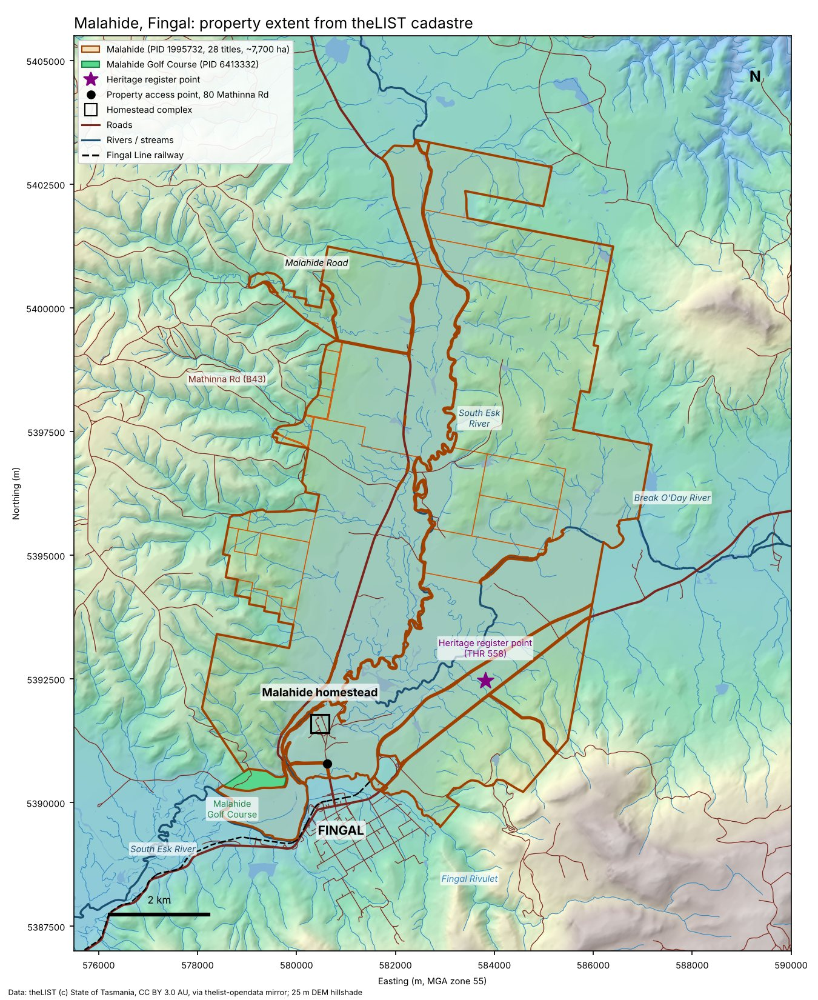
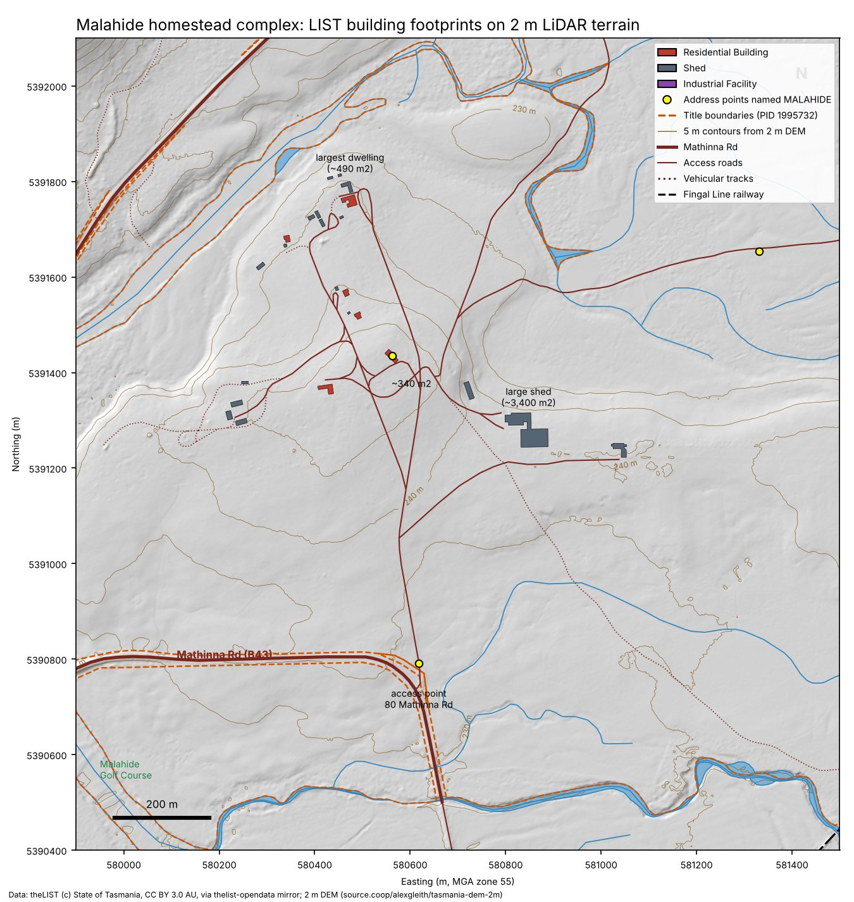
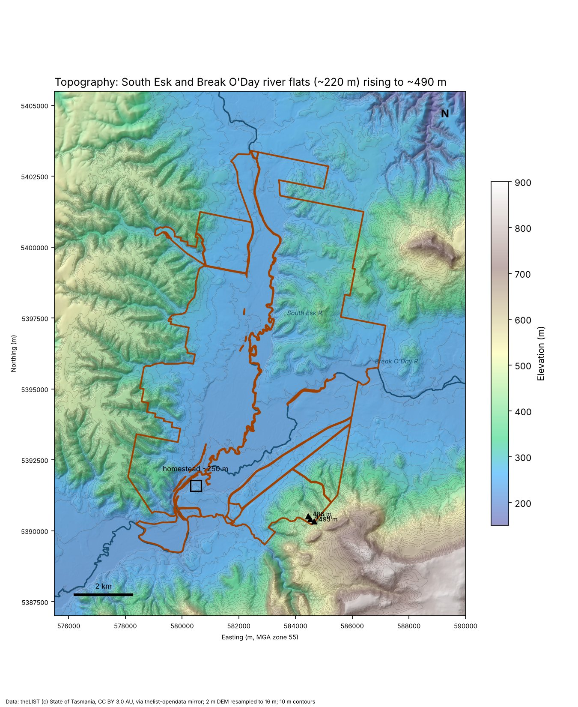
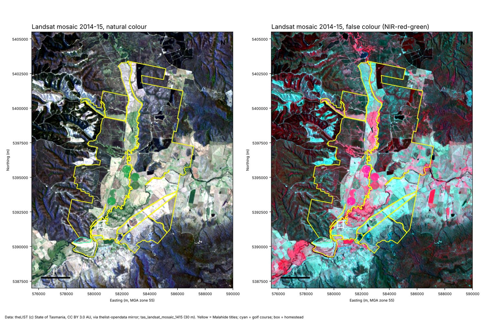
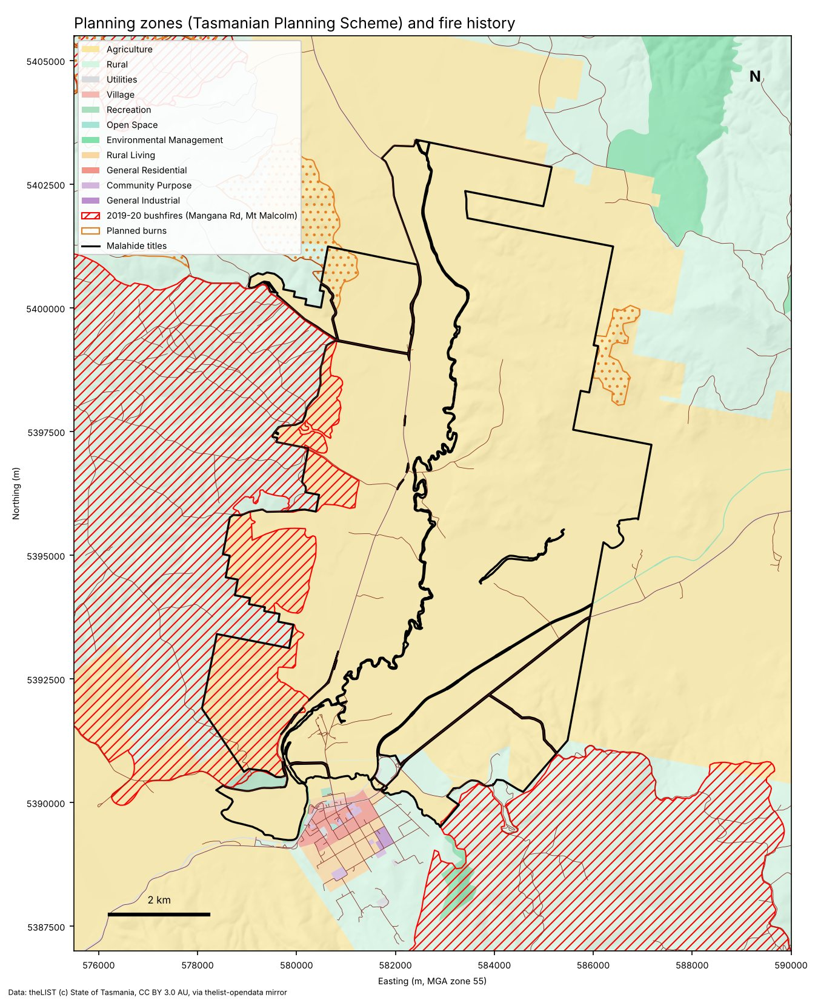

**Place page:** [Malahide](../places/malahide-1995732.qmd)

## In short

Malahide is a historic homestead and sheep station at **80 Mathinna Road, Fingal TAS 7214**, in the Fingal Valley of north-east Tasmania (Break O'Day municipality). It is on the Tasmanian Heritage Register. On theLIST it is identified by **property ID (PID) 1995732**, but the name "Malahide" is not stored on the cadastral parcels themselves, which is the main reason it is hard to find.

## Where it is

| | |
|---|---|
| Address | 80 Mathinna Road, Fingal TAS 7214 |
| Municipality | Break O'Day |
| Locality | Fingal (a locality, not a council area) |
| Property access point | about 41.6305 S, 147.9679 E (MGA55: E 580618, N 5390791) |
| Homestead building centroid | about 41.6247 S, 147.9671 E (MGA55: E 580563, N 5391435) |
| Heritage register point | about 41.6151 S, 148.0060 E (MGA55: E 583818, N 5392468) |
| Extent of all parcels under PID 1995732 | roughly 147.938 to 148.045 E, 41.645 to 41.516 S (about 9 km by 14 km) |

The homestead sits just north-east of Fingal township, off Mathinna Road (B43), which runs north from the Esk Highway towards Mathinna.

**Things with the same name nearby (easy to confuse):**

- **Malahide Golf Course**, 14 Mangana Road, Fingal. A separate property (PID 6413332), a short distance west of the homestead entrance.
- **Malahide Road**, a gazetted road name, about 10 km north of the homestead.
- **Malahide, County Dublin, Ireland**, the original Malahide, which is in the Irish county of *Fingal*. A web or map search for "Malahide Fingal" will mostly return Irish results.

## What it is

Malahide was established by William Talbot, a younger son of the Irish Talbot de Malahide family, who arrived in Hobart in 1820. He developed it into a sheep station and named it after the family seat, Malahide Castle near Dublin.

The first timber homestead burnt down in 1835 and was replaced by a two-storey Georgian house, which forms the core of the present house. Over time the property grew into a cluster of buildings: manager's house, workers' cottages, stables, coach house and farm sheds. For much of the later nineteenth century it was run by managers.

The Irish and Tasmanian Malahides eventually came to the same heir, Milo Talbot, 7th Baron Talbot de Malahide. After his death in 1973 the Irish castle was sold, and his sister Rose Talbot moved to the Tasmanian property, where she lived until her death in 2009.

The dated, sourced claims behind this summary are on the [place page](../places/malahide-1995732.qmd#history).

The Talbot connection is visible in Fingal itself: the main street is Talbot Street, and the Talbot Arms is one of about 25 heritage-registered places in and around the town.

## Structures on the property

Historical accounts describe a two-storey homestead with a cluster of buildings around it. The front block and stables are thought to date from William Talbot's time.

What theLIST shows on the 28 titles:

- **39 building footprints**: 9 classed as residential, 29 sheds and 1 industrial facility. None carries a name.
- **The homestead complex** sits on a low rise at about 245-250 m, roughly 700 m north of the Mathinna Road entrance. The largest residential footprint (about 490 m2) is at the north end of the cluster. Two more of about 340-350 m2 and several of about 130-145 m2 are nearby. A big farm shed group (one footprint about 3,400 m2) is about 300 m to the east.
- **Matching buildings to the history is inference.** The sizes fit a main house, a manager's house and workers' cottages, but theLIST does not say which is which.
- **Other infrastructure**: 8 transmission-line pylons cross the titles, and the Fingal Line railway runs along the southern edge near the town.

## Maps





## Topography

- The titles take in the **flats of the South Esk River and its confluence with the Break O'Day River**. Elevation runs from about **223 m** on the river flats to about **490 m** on the hills at the southern edge, with a median of about **256 m**.
- **The South Esk meanders north-south through the middle of the property**, and many title boundaries follow it. Pig Creek, Mullens Creek and Big and Little Hospital Creeks drain the hills on either side.
- **Named landscape features** overlapping the titles include Inside Plain, Outside Plain, Haslemere Flats, Headlams Flat, Giles Marsh, Woodlawn Marsh, Blackmans Marsh, Wards Ridge, Daylight Spur and White Hut Bend.
- **The homestead sits on a slight rise at about 248 m**, a few metres above the flood flats.



## Imagery

- **Open imagery in the mirror** is the LIST statewide Landsat mosaics (30 m): 2009-10, 2013-14 and 2014-15.
- **The river flats stand out as improved pasture and cropping**, including several circular irrigated paddocks along the South Esk. The hills to the west and south are forested.
- **Finer imagery** is viewable in LISTmap but is not part of the open bulk downloads.



## Planning and fire history

- **Planning zones**: about **7,590 ha Agriculture Zone** (about 99% of the titles), about 88 ha Rural and about 17 ha Utilities.
- **Fire history**: the **Mangana Road bushfire** (started 30 December 2019) burnt about **860 ha of the western titles**. A **planned burn named "Malahide Road"** (May 2018) covered about 52 ha in the north-west.



## Why it is hard to find on theLIST

- **Parcels carry no property name.** Clicking a parcel in LISTmap will not say "Malahide".
- **The placenames gazetteer does not register the property.** It has "Malahide Road" and "Malahide Golf Course", so a placename search lands on the road or the golf course.
- **The name lives in two other layers:** the `PROP_NAME` field of address points, and the `NAME` field of the heritage register.
- **"Fingal" is a locality, not a municipality.** Filtering by council needs *Break O'Day*.

## How to find it

| Layer (thelist-opendata) | Match on | What you get |
|---|---|---|
| `list_address_points` | `PROP_NAME = 'MALAHIDE'` | 3 points (access point, building, rural centroid); PID 1995732 |
| `list_heritage_register` | `NAME = 'Malahide'` | THR ID 558, Permanently Registered, title 251643/1 |
| `list_parcels` (Break O'Day file) | `PID = 1995732` | 28 freehold parcels, about 7,696 ha in total |
| `list_nomenclature_csv` | `FEAT_NAME LIKE 'Malahide%'` | only Malahide Road and Malahide Golf Course |

```sql
INSTALL spatial; LOAD spatial; INSTALL httpfs; LOAD httpfs;

SELECT VOLUME, FOLIO, LPI, TENURE_TY, COMP_AREA
FROM 'https://data.source.coop/mdsumner/thelist-opendata/geoparquet/list_parcels/break_o_day/list_parcels_break_o_day.parquet'
WHERE PID = 1995732;
```

## Caveats

- **PID is a property grouping, not one title.** The 7,696 ha is the sum of all 28 titles. That is the working property, not the original grant, and not the heritage-listed area.
- **The heritage listing names one title (251643/1).** The register point sits about 3 km east of the homestead, so it is a reference location, not a marker on the house.
- **Not every account is careful about the golf course.** At least one article says the Talbot estate "is now a golf course". In the LIST data the golf course is a separate, small property.
- **Data currency.** Values come from the mirror as synced in November 2026. Ownership is not in the open data, and this report does not cover it.
