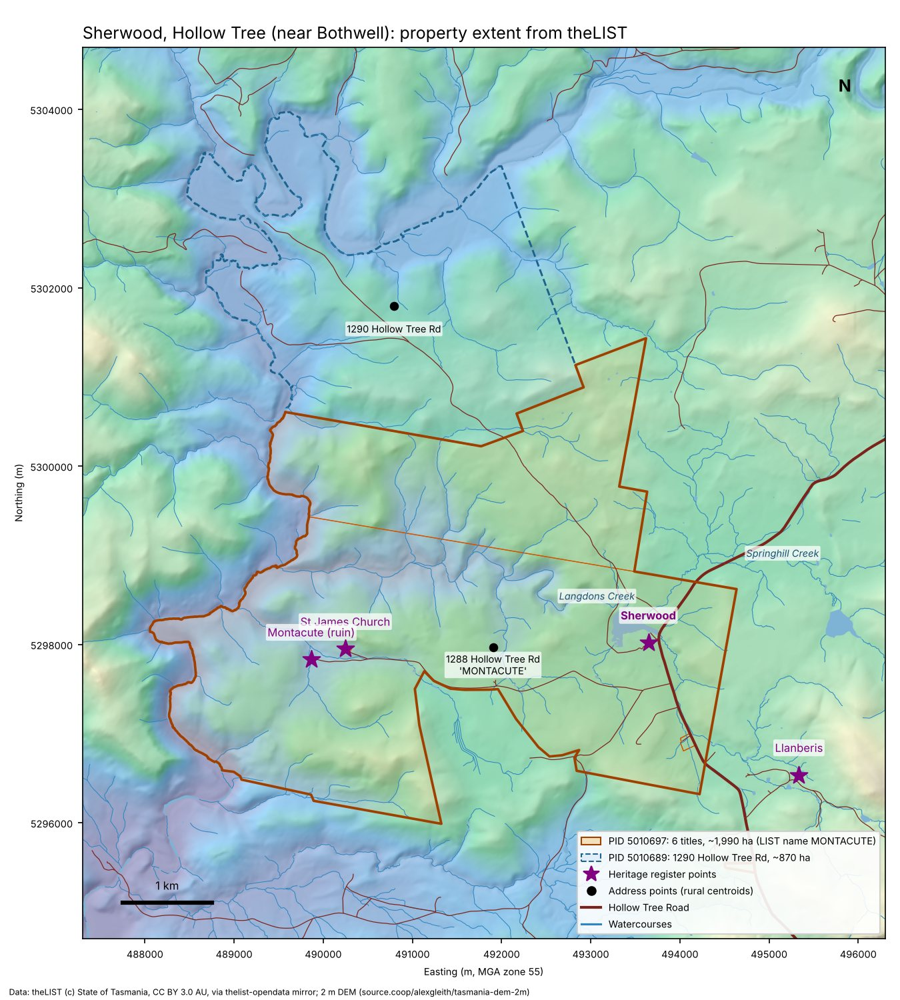
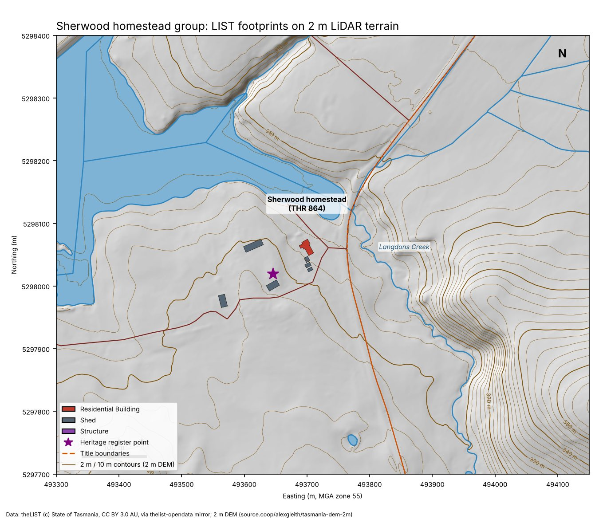
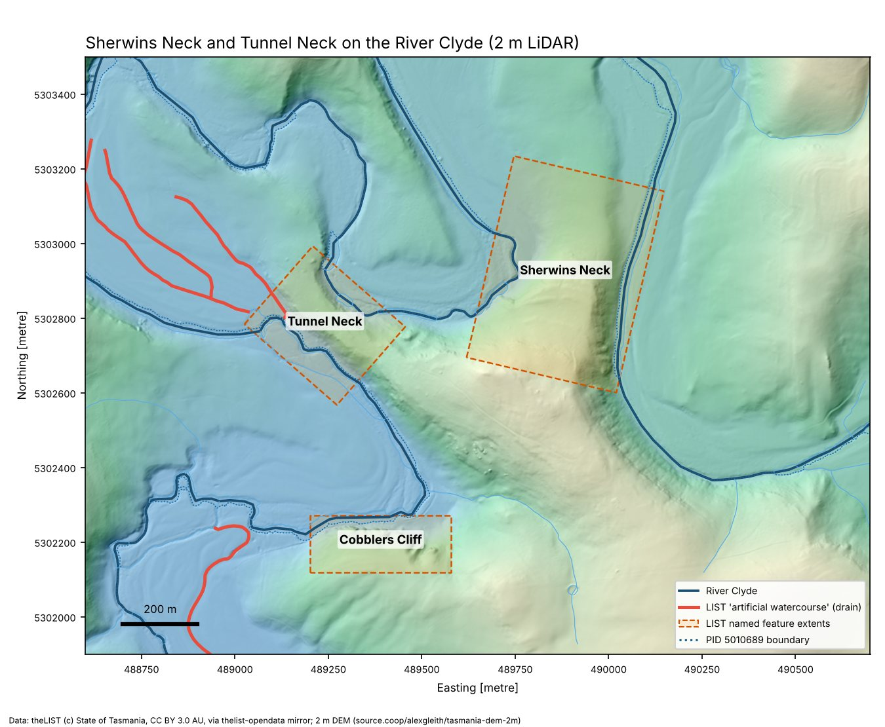
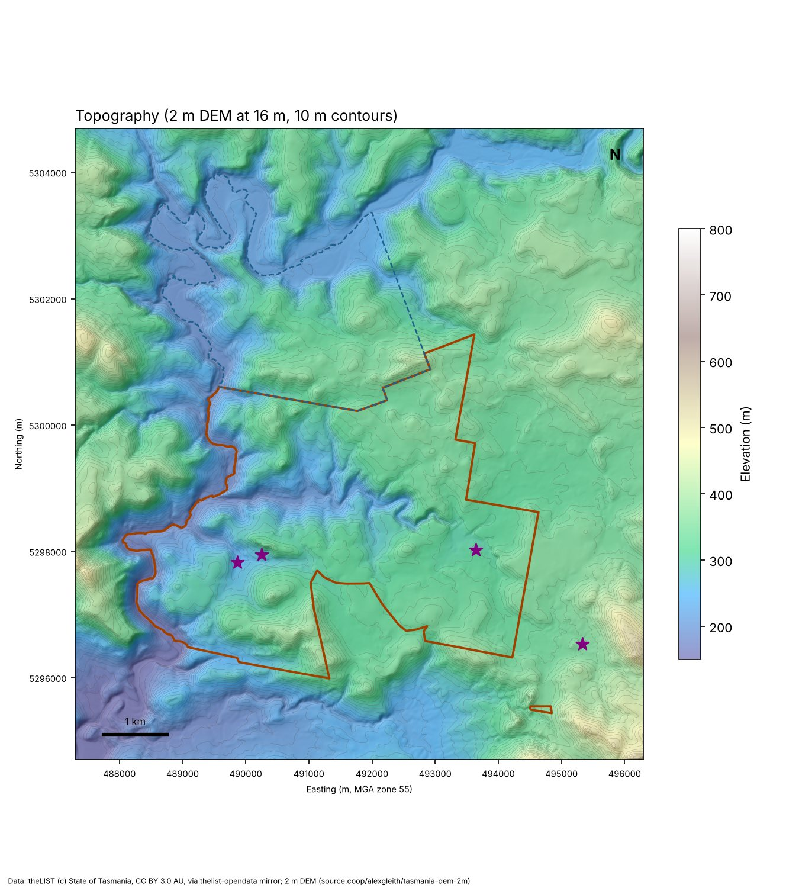
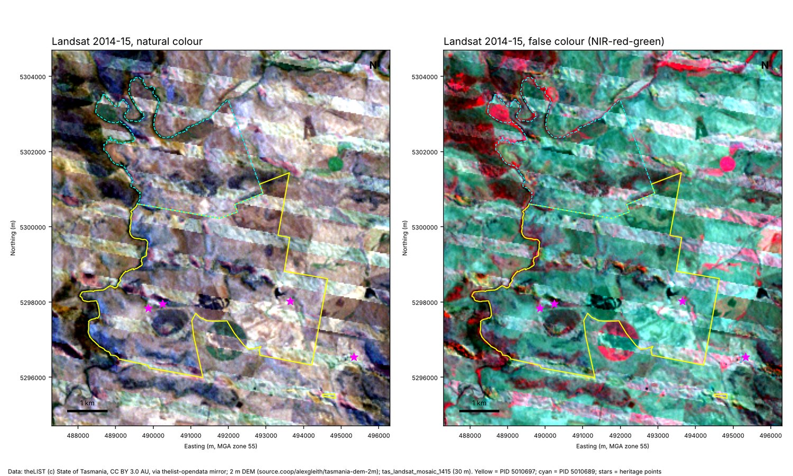
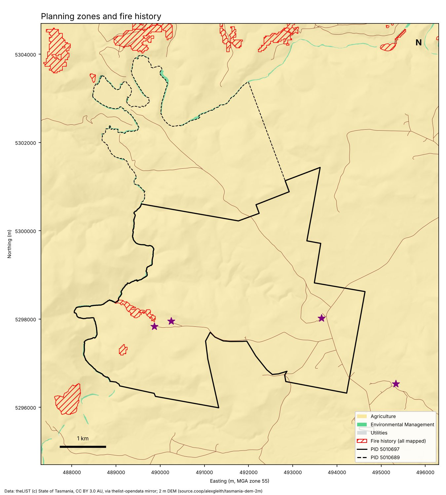

**Place pages:** [Montacute holding (homestead)](../places/montacute-5010697.qmd) and [1290 Hollow Tree Road](../places/sherwood-1290-hollow-tree-road-5010689.qmd)

## In short

Sherwood is a Georgian sandstone homestead (1842) and its outbuildings at **Hollow Tree, about 12 km south-west of Bothwell**, in the Central Highlands. It was built for the Sherwin family on land granted along the River Clyde in 1823.

On theLIST it is harder to find than most:

- **No address point is named Sherwood.** The homestead sits on a holding whose address point (1288 Hollow Tree Road, PID **5010697**) is named **MONTACUTE**, after a neighbouring historic property on the same holding.
- **The name appears in two other places.** The heritage register has "Sherwood" (THR 864), and the named-feature layer has **Sherwins Neck** and **Tunnel Neck** on the River Clyde.
- **The heritage address has changed.** A 2022 provisional heritage entry (THR 12036) gives **1290 Hollow Tree Road**, a different property (PID 5010689) to the north.

## Where it is

| | |
|---|---|
| Homestead | about 42.4697 S, 146.9232 E (MGA55: E 493690, N 5298065), about 307 m elevation, just west of Hollow Tree Road |
| Heritage point (THR 864) | E 493646, N 5298020; title 121056/1 |
| Holding with the homestead | PID 5010697, 1288 Hollow Tree Road, LIST name MONTACUTE: 6 titles, about 1,990 ha |
| Holding named in the 2022 heritage notice | PID 5010689, 1290 Hollow Tree Road: title 147677/1, about 870 ha, bounded on the west by the River Clyde |
| Municipality and locality | Central Highlands; locality Hollow Tree (postcode 7140) |

**Same-name traps**

- **Montacute** (heritage ruin) and **St James Church** are on the same holding as Sherwood, about 3.5 km west.
- **Sherwood Road** (gazetted 1973) is about 2.5 km north-west of the homestead.
- **Elsewhere in Tasmania:** the Sherwood Castle Inn at Ross, plus properties named SHERWOOD at Stieglitz, Dilston, Swan Bay, Deviot and Mengha.

## What it is

Sherwood was the Sherwin family's farm on the River Clyde, in the country of the Big River nation, below Bothwell. By the 1820s Hollow Tree was ringed by land grants that became some of the Central Highlands' best-known sandstone homesteads: Sherwood, Montacute, Strathborough, Rathmore and Llanberis.

The present house is a **Georgian sandstone homestead built in 1842**, with a hipped roof, a three-bay facade and a cellar running back into the hill. Sandstone outbuildings around it include a kitchen, bakery, coach house, barn and cottages. It replaced an earlier timber house that was **burnt in 1830 during the Black War**.

Two episodes made it well known. In **March 1843 the bushranger Martin Cash** and two companions robbed Sherwood. Then in **1845 Isaac Sherwin** directed the hand-cutting of a **137 m tunnel through sandstone** to carry irrigation water, described as one of Tasmania's first irrigation works.

The house was not lived in regularly from the 1950s and was restored in the 1970s with the help of a Hobart scout group.

The dated, sourced claims are on the [place page](../places/montacute-5010697.qmd#history).

## Structures on the property

**The Sherwood homestead group** sits on a low terrace at about 307 m, 86 m west of Langdons Creek, with a large farm dam to the north-west. LIST footprints there are:

- one residential building of about 270 m2 (the sandstone homestead), with three small adjoining structures;
- about seven sheds (37-306 m2) around it, matching the historical outbuildings.

None of these footprints carries a name in LIST, so matching them to the history is inference.

**Across the whole holding** LIST maps 26 footprints, including **one ruin** (Montacute) and **one place of worship** (St James Church, the only footprint with a LIST name).

**The tunnel itself is not in LIST.** At Tunnel Neck, LIST maps "artificial watercourse (drain)" lines running from the narrow neck between two Clyde meanders across the river flats. That pattern fits a tunnel feeding an irrigation race, but it is an inference from the layers, not a confirmed match.

## Maps

## Topography, imagery, planning and fire

- **The holdings span the River Clyde valley.** Elevation on PID 5010697 runs from about 150 m at the river to about 400 m on Montacute Hill.
- **The Clyde meanders in deep loops** along the western boundary. Sherwins Neck and Tunnel Neck are the narrow necks between those loops.
- **The 2014-15 Landsat mosaic** shows dry grazing country with darker woodland on the slopes and several circular irrigated paddocks. The diagonal stripes are an artefact of the mosaic, not on the ground.
- **Zoning:** effectively all of PID 5010697 is in the Agriculture Zone.
- **Fire history:** light. Two small fires of unknown type (2012, about 3 ha; 2018, about 11 ha).

## Why it is hard to find on theLIST

- **No address point is called Sherwood.** The homestead's holding is named MONTACUTE.
- **The gazetteer has only Sherwood Road**, not the property.
- **The heritage register in the mirror holds only the older THR 864.** The 2022 entry points to a different property ID from the one the homestead stands on.
- **The best clues are in the named-feature layer:** Sherwins Neck and Tunnel Neck.
- **The locality is Hollow Tree, not Bothwell.**

## How to find it

| Layer (thelist-opendata) | Match on | What you get |
|---|---|---|
| `list_heritage_register` | `NAME = 'Sherwood'` and `ADDRESS LIKE '%HOLLOW TREE%'` | THR 864, PID 5010697, title 121056/1 |
| `list_parcels` (Central Highlands) | `PID = 5010697` | 6 titles, about 1,990 ha |
| `list_parcels` (Central Highlands) | `PID = 5010689` | title 147677/1, about 870 ha |
| `list_named_feature_extent` | `NAME IN ('Sherwins Neck','Tunnel Neck')` | the Sherwin landforms on the River Clyde |

## Caveats

- **Two property IDs.** The homestead buildings are on PID 5010697 in the mirrored cadastre, while the 2022 heritage notice gives 1290 Hollow Tree Road (PID 5010689). The heritage datasheet for THR 12036 is the authority.
- **The tunnel location is inferred**, not confirmed on the ground or in the heritage documents.
- **Data currency.** Values come from the mirror as synced in November 2026. Ownership is not in the open data, and this report does not cover it.
